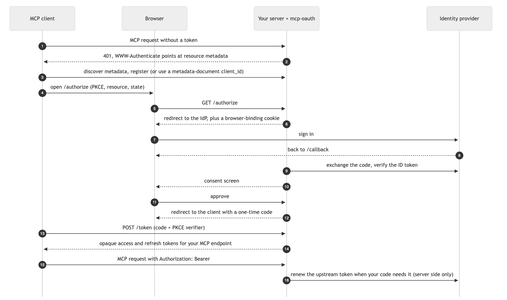

<h1 align="center">@gydr-ai/mcp-oauth</h1>

<p align="center">
  <strong>OAuth 2.1 for remote MCP servers, in front of the identity provider you already run.</strong><br />
  Its own audience-bound tokens, consent on every connection, and no token passthrough.
</p>

<p align="center">
  <a href="https://www.npmjs.com/package/@gydr-ai/mcp-oauth"></a>
  <a href="https://github.com/gydr-ai/mcp-oauth/actions/workflows/ci.yml"></a>
  <a href="https://scorecard.dev/viewer/?uri=github.com/gydr-ai/mcp-oauth"></a>
  
  
  
  
  <a href="LICENSE"></a>
</p>

<p align="center">
  <sub>Built and maintained by <a href="https://gydr.ai"><strong>Gydr</strong></a></sub>
</p>

---

A remote [Model Context Protocol](https://modelcontextprotocol.io) server
must run an OAuth authorization server that MCP clients (Claude, ChatGPT,
Cursor and others) can discover, register with and sign in through. You
already have an identity provider; you do not want to hand its tokens to
every MCP client that asks.

`@gydr-ai/mcp-oauth` is that authorization server. People sign in at **your
OpenID Connect provider**, approve the connection on a consent screen, and
the MCP client receives **opaque tokens that only your MCP server accepts**.
The provider's tokens never leave your server.

## Highlights

- **Spec-complete for MCP.** Protected-resource and authorization-server
  metadata, Client ID Metadata Documents, Dynamic Client Registration
  (deprecated, still on by default), PKCE, resource indicators and issuer
  identification: everything the
  [MCP Authorization specification](https://modelcontextprotocol.io/specification/2026-07-28/basic/authorization)
  asks of a server.
- **No token passthrough.** Clients get tokens bound to your MCP endpoint.
  The person's upstream refresh token stays on the server, encrypted per
  grant, and your code calls `getUpstreamAccessToken()` when it needs one.
- **Consent every time.** Each authorization names the client and where the
  result goes, which closes the "confused deputy" gap the MCP
  [security best practices](https://modelcontextprotocol.io/specification/2026-07-28/basic/security_best_practices)
  describe. It cannot be switched off.
- **Hardened by default.** Exact redirect matching, browser-bound flows,
  single-use codes, refresh-token rotation with replay detection, strict page
  headers, and SSRF-safe metadata downloads.
- **Fits any stack.** Web `Request` in, `Response` out: Hono, Next.js,
  Fastify, Express, plain Node. Any OIDC provider, any database with an
  atomic write, any key-management service.
- **Safely extensible.** Policy hooks that can only refuse, enrichment hooks
  that cannot touch the protocol, and every limit configurable.

## Contents

- [How it works](#how-it-works)
- [Install](#install)
- [Quick start](#quick-start)
- [Guides](#guides)
- [API](#api)
- [Security model](#security-model)
- [Specification compliance](#specification-compliance)
- [Compatibility](#compatibility)
- [Security](#security)
- [About Gydr](#about-gydr)

## How it works

<!-- Source: .github/assets/how-it-works.mmd. npm does not render Mermaid, so the
     chart ships as a PNG. Regenerate with @mermaid-js/mermaid-cli (theme neutral,
     white background, scale 2) after editing the source. -->
<p align="center">
  
</p>

## Install

```bash
npm install @gydr-ai/mcp-oauth
```

Node.js 22.23.5+, 24.22.3+ or 26.13.1+ (the November 2026 Node.js security
releases). ES modules only. Runtime dependencies:
[`jose`](https://github.com/panva/jose) and
[`@gydr-ai/safe-fetch`](https://github.com/gydr-ai/safe-fetch).

## Quick start

With [Hono](https://hono.dev):

```ts
import { serve } from "@hono/node-server"
import { Hono } from "hono"
import {
  createAesGcmSealer,
  createMcpAuth,
  createMemoryStore,
  createOidcProvider,
} from "@gydr-ai/mcp-oauth"

const ORIGIN = "https://mcp.example.com"

const auth = createMcpAuth({
  issuer: ORIGIN,
  resource: `${ORIGIN}/mcp`,
  identityProvider: createOidcProvider({
    issuer: process.env.OIDC_ISSUER ?? "",
    clientId: process.env.OIDC_CLIENT_ID ?? "",
    clientSecret: process.env.OIDC_CLIENT_SECRET ?? "",
    scopes: ["openid", "email", "offline_access"],
    redirectUri: `${ORIGIN}/callback`, // register exactly this at your IdP
  }),
  store: createMemoryStore(), // development only, see the production checklist
  sealer: createAesGcmSealer({
    keys: { k1: Buffer.from(process.env.SEALING_KEY ?? "", "base64") },
    currentKid: "k1",
  }),
})

const app = new Hono()

// OAuth routes and metadata; anything else falls through.
app.use("*", async (c, next) => (await auth.handle(c.req.raw)) ?? next())

app.all("/mcp", async (c) => {
  const result = await auth.authenticate(c.req.raw)

  if (!result.ok) return result.response // 401 with the right challenge

  // result.subject, result.scopes, result.clientId, result.context
  // await result.getUpstreamAccessToken() to call your own APIs as the person
  return handleMcp(c.req.raw, result)
})

serve({ fetch: app.fetch, port: 3000 })
```

A sealing key is 32 random bytes:

```bash
node -e "console.log(require('node:crypto').randomBytes(32).toString('base64'))"
```

## Guides

### Node `http` and Express

Two small conversions, Node built-ins only. Build URLs from your configured
public origin, never from the incoming `Host` header.

```ts
import type { IncomingMessage, ServerResponse } from "node:http"
import { Readable } from "node:stream"

const PUBLIC_ORIGIN = "https://mcp.example.com"

export function toWebRequest(req: IncomingMessage): Request {
  const headers = new Headers()

  for (const [name, value] of Object.entries(req.headers)) {
    if (Array.isArray(value)) for (const v of value) headers.append(name, v)
    else if (value !== undefined) headers.set(name, value)
  }

  const hasBody = req.method !== "GET" && req.method !== "HEAD"

  return new Request(new URL(req.url ?? "/", PUBLIC_ORIGIN), {
    method: req.method,
    headers,
    body: hasBody ? Readable.toWeb(req) : null,
    // @ts-expect-error Node needs this for a streamed request body
    duplex: hasBody ? "half" : undefined,
  })
}

export async function sendWebResponse(
  res: ServerResponse,
  response: Response,
): Promise<void> {
  res.statusCode = response.status
  response.headers.forEach((value, name) => {
    if (name !== "set-cookie") res.setHeader(name, value)
  })

  const cookies = response.headers.getSetCookie()

  if (cookies.length > 0) res.setHeader("set-cookie", cookies)

  res.end(Buffer.from(await response.arrayBuffer()))
}
```

Express (mount before any body parser, so the body stream is untouched):

```ts
import express from "express"

const app = express()

app.use(async (req, res, next) => {
  try {
    const response = await auth.handle(toWebRequest(req))

    if (response) await sendWebResponse(res, response)
    else next()
  } catch (error) {
    next(error)
  }
})

app.all("/mcp", async (req, res, next) => {
  try {
    const request = toWebRequest(req)
    const result = await auth.authenticate(request)

    if (!result.ok) return await sendWebResponse(res, result.response)

    await sendWebResponse(res, await handleMcp(request, result))
  } catch (error) {
    next(error)
  }
})

app.listen(3000)
```

Plain Node `http` works the same way: call `auth.handle`, then
`auth.authenticate` on your MCP path.

### Extending safely

Every extension point can **tighten**, **enrich** or **observe**. None can
switch off PKCE, exact redirect matching, consent, the browser binding and
form token, single-use codes, refresh replay detection, audience binding,
opaque tokens, or the escaping and Content-Security-Policy on pages.

```ts
const auth = createMcpAuth({
  // ...issuer, resource, identityProvider, store, sealer
  scopes: ["mcp:read", "mcp:write"],
  scopeDescriptions: {
    "mcp:read": "Read your documents",
    "mcp:write": "Create and edit documents",
  },
  clients: [
    {
      clientId: "team-desktop",
      clientName: "Team Desktop",
      redirectUris: ["http://127.0.0.1/callback"],
      grantTypes: ["authorization_code", "refresh_token"],
    },
  ],
  authorizeClient: ({ client, scopes }) =>
    client.kind !== "dynamic" || !scopes.includes("mcp:write"),
  allowSubject: ({ claims }) => claims.email_verified === true,
  mapSubject: ({ subject, claims }) => ({
    subject,
    displayName: typeof claims.email === "string" ? claims.email : undefined,
  }),
  getGrantContext: async ({ subject }) => ({ tenant: await tenantOf(subject) }),
})
```

**Policy hooks** run only after every protocol check has passed. Only a
literal `true` (or `{ allow: true }`) continues; `false`, any other value, a
rejection or a throw refuses. A refusal may name a reason,
`{ allow: false, reason: "no_seat" }` (1–64 characters of
`A-Z a-z 0-9 _ . : -`), which reaches your error page as `policyReason`.
Every hook receives deeply frozen copies of the data it inspects (the
client, scopes, metadata, claims and grant), so it can read validated state
but cannot change what the server goes on to use.

| Hook                     | Called                                 | On refusal                                                                                            |
| ------------------------ | -------------------------------------- | ----------------------------------------------------------------------------------------------------- |
| `authorizeClient`        | `/authorize`, after full validation    | 403 page (`reason: "access_denied"`)                                                                  |
| `allowRegistration`      | `/register`, after the metadata checks | `403 invalid_client_metadata`, nothing stored                                                         |
| `allowSubject`           | after sign-in and `mapSubject`         | 403 page, upstream refresh token revoked                                                              |
| `allowClientMetadataUrl` | before a metadata document is fetched  | the client is unknown, nothing is fetched                                                             |
| `beforeGrant`            | after approval, before the grant       | `access_denied` to the client, upstream revoked                                                       |
| `beforeTokenIssue`       | before a code or refresh token is used | `invalid_grant`; a throw is `503 temporarily_unavailable`, and the code or refresh token stays usable |

**Enrichment hooks**

- `mapSubject({ subject, displayName, claims })` returns
  `{ subject, displayName? }`, for example to key grants on your own user
  id. Each returned field is read once. The subject (mapped or not) must be
  a non-empty string of at most 512 characters, without surrounding
  whitespace, in Unicode NFC form and free of invisible or formatting
  characters; otherwise sign-in stops and the upstream token is revoked. A
  display name with such characters, or longer than
  `limits.clientNameLength`, is dropped.
- `getGrantContext(grant)` returns JSON data exposed as
  `AuthResult.context` (a tenant id, a plan), within
  `limits.grantContextBytes`. It cannot change the subject, scopes or
  audience, and tokens never carry it. If it throws, or returns data that is
  too large or not serializable, `authenticate` returns `{ ok: false }` with a
  generic 500 response and emits `grant_context_failed`; the hook's error
  text is never returned or reported.

**Consent extensions**

Your consent page can ask for more than yes or no (a workspace, a plan),
and the answer can travel with the grant.

```ts
const auth = createMcpAuth({
  // ...
  // Data for your consent page, as `details` in ConsentPageContext.
  getConsentDetails: async ({ subject }) => ({
    workspaces: await workspacesOf(subject),
  }),
  // Your page's extra fields, read only after the form token and the
  // browser cookie were verified.
  readConsentFields: ({ form, details }) =>
    form.workspace === undefined
      ? { ok: false, fieldErrors: { workspace: "Choose a workspace" } }
      : { ok: true, grantData: { workspace: form.workspace } },
  beforeGrant: async ({ subject }) =>
    (await hasSeat(subject)) ? true : { allow: false, reason: "no_seat" },
  afterGrant: ({ grant }) => recordConnection(grant.grantId, grant.subject),
  getGrantContext: ({ data }) => ({ workspace: data }),
})
```

- `getConsentDetails` runs at the callback; its JSON result
  (`limits.consentDetailsBytes`) reaches the page and `readConsentFields`.
  A throw ends the sign-in with an error page and revokes the upstream
  token.
- `readConsentFields` never sees the package's own fields. `fieldErrors`
  shows the page again (status 400, with `fieldErrors` and `submitted`)
  and uses nothing up; `grantData` (`limits.grantDataBytes`) is stored as
  `GrantRecord.data`, passed to `getGrantContext`, and can be replaced
  later with `auth.updateGrantData(grantId, data)`. A throw or an unusable
  result ends the flow with a 500 page and revokes the upstream token.
- `afterGrant` is awaited before the client is answered. If it throws, the
  grant is deleted, the upstream token revoked and the client receives
  `error=server_error`.
- `scriptHashes: ["sha256-…"]` lets a custom consent page run those inline
  scripts (`script-src`); only `sha256-` hashes are accepted.
- A consent submission repeated from the same browser within
  `consentReplaySeconds` (default 10, at most 60) receives the same
  redirect again, when the store implements the optional
  `putConsentOutcome` / `getConsentOutcome`; otherwise a repeat sees an
  error page. A repeat that arrives while the first is still being decided
  (in `beforeGrant` or `afterGrant`) waits for its answer, within the same
  window; the first leaves a short "being decided" mark for that, so a
  forged repeat, which finds none, is answered at once. Everything
  remembered is stored encrypted.

**Pages**

`renderConsentPage` and `renderErrorPage` receive deeply frozen contexts
with `locales` (from `Accept-Language`, most preferred first). Error pages
carry a stable `reason` code (`client_unknown`, `invalid_scope`,
`subject_not_permitted`, …) to switch on for your own wording, plus
`policyReason` when a hook gave one.

**Upstream tokens and connections**

- `IdentityProvider.refresh(refreshToken, { grantId, subject })` tells a
  custom provider which grant a renewal is for.
- `result.getUpstreamAccessToken({ forceRefresh: true })` and
  `auth.renewUpstream(grantId)` discard the cached upstream access token
  (in memory and on the grant) and renew it, for example after the
  provider answered 401. Concurrent renewals of one grant share one call.
- `auth.revokeGrantsForSubject(subject)` ends every grant of one person
  (for an account closure) when the store implements the optional
  `listGrantsBySubject`; without it, it throws `McpAuthConfigError`.
- The `grant_revoked` event carries a frozen copy of the grant (never its
  encrypted upstream tokens) and is emitted before the grant is deleted.

**Checked configuration**

- `clients`: pre-registered public clients, held to the same rules as
  registration. An `https` client id is refused (that form means a metadata
  document).
- `scopeDescriptions`: consent-screen text per supported scope, escaped.

There is deliberately no hook to replace the random source or to add claims
to tokens: either would let configuration weaken token secrecy.

### Implementing a store

You implement `OAuthStore` on your own database. It only ever receives
SHA-256 hashes of tokens and codes, and upstream tokens already encrypted.

Four operations decide races and **must be atomic across every process that
shares the store**: a conditional write, a transaction, a compare-and-set,
or a delete that returns the row, never a read followed by a write.

| Operation                         | Contract                                                             | Why                                            |
| --------------------------------- | -------------------------------------------------------------------- | ---------------------------------------------- |
| `consumePendingAuthorization(id)` | One caller receives the record, which is deleted.                    | A sign-in completes once.                      |
| `consumeConsentRequest(id)`       | The same; should still return a held record that has expired.        | One approval creates one grant.                |
| `consumeAuthorizationCode(hash)`  | Exactly one caller sees `firstUse: true`; later callers see `false`. | Codes are single-use and a repeat is detected. |
| `useRefreshToken(hash, now)`      | Sets `usedAt` if unset; exactly one caller sees no `previousUsedAt`. | Refresh replay detection cannot be raced.      |

Expired records read as absent and may be deleted at any time, for example
by a database TTL (`getConsentRequest` may also return an expired one).
`deleteGrant` must make `getGrant` return nothing, and should resolve with
the deleted record so the last stored upstream token is the one revoked.
`getAuthorizationCode` reads a code, consumed or not, without using it up:
the token endpoint checks the client, redirect URI, resource and PKCE
verifier against it first.

`updateGrant` must save every field it is given, including `expiresAt`
(sent on refresh under `lifetimes.grantIdle`); `putGrant` must keep the
whole record, including the optional `redirectUri`.

Four methods are optional: `putRefreshTokenReplacement` (recommended; see
below), `putConsentOutcome` / `getConsentOutcome` (answering a repeated
consent submission; one submission writes twice, the "being decided" mark
and then the answer, so a later write replaces an earlier one) and
`listGrantsBySubject` (`revokeGrantsForSubject`).

**Refresh retries.** `putRefreshTokenReplacement(hash, sealedReplacement)`
saves, on the refresh token record just used, the pair it was exchanged
for, encrypted by your `SecretSealer`; keep every other field (`usedAt`
included) and return `sealedReplacement` from `getRefreshToken` and
`useRefreshToken` afterwards. A refresh token presented again within
`refreshReuseGraceSeconds` then receives exactly that pair, so a copied
token never starts a second chain: once either holder rotates the shared
pair, the other's next use is a replay and the grant ends. A retry that
arrives while the first exchange is still storing its pair gets
`503 temporarily_unavailable`. Without the method, a retry within the
window receives an access token only, with no refresh token, and the
client keeps the refresh token from the response it lost (re-presenting the
original one within the window if that response never arrived).

**Key length.** Any `client_id` a caller sends, up to 2,048 characters,
can reach `getClient`, and a Client ID Metadata Document URL of that length
reaches `getCachedClientMetadata` and `putCachedClientMetadata` as a key
(and grants and tokens carry it as a field). Some databases cap key or index
length near that (a DynamoDB partition key is at most 2,048 bytes, a MySQL
index prefix often 767 or 3,072 bytes), especially once you add a prefix.
Hash long ids into the key, or refuse them in the adapter (`getClient` and
`getCachedClientMetadata` resolving `undefined`, `putCachedClientMetadata`
skipping the write); never truncate one, since two ids would then share a
record, and never let a too-long key throw.

Good fits: PostgreSQL or MySQL (`UPDATE … WHERE used_at IS NULL`,
`DELETE … RETURNING`), Redis (`GETDEL`, Lua), MongoDB (`findOneAndUpdate`),
DynamoDB (conditional writes) and Cloudflare D1.

**Client lifetime.** Anyone can call `/register`, so a store should never
evict a client that holds a live grant, should delete a dynamic client
without one after an idle period (28 days in the memory store), and should
evict the least recently used grant-less dynamic client first when full.

### Production checklist

- [ ] **A persistent, shared store** that honours the atomicity contract.
- [ ] **Managed keys.** Sealing keys come from a secret manager, KMS or HSM.
      Rotate by adding a key id, making it `currentKid`, and keeping the old
      key until no grant sealed with it remains (`lifetimes.grant`).
- [ ] **HTTPS** for the issuer and resource.
- [ ] **Rate limiting** through `rateLimit` and `getClientIp` (or
      `trustProxy` behind exactly one proxy you control). **Without
      `getClientIp` or `trustProxy`, every request shares the single key
      `"unknown"`**, so one busy client can exhaust the limit for everyone.
      Without `rateLimit`, `POST /register` is open to flooding. A starting
      point: 10 registrations per address per hour, 30 authorization starts
      per address per minute.
- [ ] **Alerts** from `onEvent` on `refresh_token_replayed`,
      `authorization_code_replayed`, and bursts of `flow_binding_mismatch` or
      `client_metadata_refused`.
- [ ] **Identity provider**: register `<issuer origin><callback path>` as the
      only redirect URI of a confidential client, request a refresh token
      (often `offline_access`), and enable refresh rotation if offered.
- [ ] **Connection management**: let people see and remove their
      connections, and call `revokeGrant` when they do or when an account
      closes.

## API

### `createMcpAuth(options)`

| Member                            | Purpose                                                                                                                                      |
| --------------------------------- | -------------------------------------------------------------------------------------------------------------------------------------------- |
| `handle(request)`                 | Serves the OAuth routes and metadata. Resolves `undefined` for any other path.                                                               |
| `authenticate(request)`           | Checks the bearer token. `{ ok: true, subject, grantId, clientId, scopes, context, getUpstreamAccessToken() }` or `{ ok: false, response }`. |
| `unauthorized(request, error?)`   | A ready 401 challenge (403 for `insufficient_scope`), e.g. when a tool needs a scope the token lacks.                                        |
| `revokeGrant(grantId)`            | Ends a grant: its tokens stop working and the upstream refresh token is revoked when possible.                                               |
| `revokeGrantsForSubject(subject)` | Ends every grant of one person; needs the store's `listGrantsBySubject`. Resolves the count.                                                 |
| `renewUpstream(grantId)`          | Discards the cached upstream access token and renews it at the identity provider.                                                            |
| `updateGrantData(grantId, data)`  | Replaces `GrantRecord.data` (JSON, within `limits.grantDataBytes`). Resolves `false` for an unknown grant.                                   |

### Options

| Option                                  | Default                                                                 | Meaning                                                                                                                                                                        |
| --------------------------------------- | ----------------------------------------------------------------------- | ------------------------------------------------------------------------------------------------------------------------------------------------------------------------------ |
| `issuer`                                | required                                                                | HTTPS URL; endpoints live under its path.                                                                                                                                      |
| `resource`                              | required                                                                | Canonical URL of your MCP endpoint, the audience of every token.                                                                                                               |
| `identityProvider`                      | required                                                                | `createOidcProvider(…)` or your own `IdentityProvider`.                                                                                                                        |
| `store`                                 | required                                                                | Your `OAuthStore`.                                                                                                                                                             |
| `sealer`                                | required                                                                | `createAesGcmSealer(…)` or your own `SecretSealer`.                                                                                                                            |
| `scopes` / `defaultScopes`              | `["mcp"]` / all                                                         | Scopes offered, and those granted when none are asked for.                                                                                                                     |
| `scopeDescriptions`                     | none                                                                    | Consent-screen text per scope.                                                                                                                                                 |
| `resourceName`                          | none                                                                    | RFC 9728 `resource_name`.                                                                                                                                                      |
| `clients`                               | none                                                                    | Pre-registered public clients.                                                                                                                                                 |
| `dynamicClientRegistration`             | `true`                                                                  | Serve `POST /register`. Deprecated by MCP 2026-07-28 in favour of metadata documents; `dynamicClientRegistration: false` turns it off.                                         |
| `clientIdMetadataDocuments`             | `true`                                                                  | Accept HTTPS URL client ids.                                                                                                                                                   |
| `fetchClientMetadata(url, { signal })`  | SSRF-safe fetcher                                                       | Replace how metadata documents are downloaded. Must stay SSRF-safe.                                                                                                            |
| `lifetimes`                             | see below                                                               | Token and flow lifetimes, in seconds.                                                                                                                                          |
| `limits`                                | see below                                                               | Sizes and counts.                                                                                                                                                              |
| `defaultGrantTypes`                     | `["authorization_code"]`                                                | Grant types for a client that registers or publishes none, applied at registration or fetch. Must include `authorization_code`. `clients` default to both.                     |
| `refreshReuseGraceSeconds`              | `10`                                                                    | Retry window (0–300) for a just-used refresh token: a retry gets the same pair again (see `putRefreshTokenReplacement`), never a second chain. `0` treats any reuse as replay. |
| `strictTransportSecurity`               | `true`                                                                  | Send `Strict-Transport-Security: max-age=63072000; includeSubDomains` on every response the package builds. `false` only if your proxy already sets it.                        |
| `consentReplaySeconds`                  | `10`                                                                    | Window (0–60) in which a repeated consent submission from the same browser gets the same redirect.                                                                             |
| `scriptHashes`                          | none                                                                    | `sha256-…` hashes of inline scripts a custom consent page may run.                                                                                                             |
| `paths`                                 | `/authorize`, `/callback`, `/consent`, `/token`, `/register`, `/revoke` | Route paths under the issuer path: one leading `/`, no `//`, `\`, dot segments or whitespace, distinct, and never a metadata path or the resource path.                        |
| `cookiePrefix`                          | `__Host-mcp-auth-`                                                      | Must start with `__Host-`.                                                                                                                                                     |
| `rateLimit(key, scope)`                 | none                                                                    | Resolve `true` to continue; anything else (including a throw) answers 429.                                                                                                     |
| `getClientIp(request)` / `trustProxy`   | none / `false`                                                          | Rate-limit key. `trustProxy` uses the right-most `X-Forwarded-For` entry.                                                                                                      |
| `renderConsentPage` / `renderErrorPage` | built in                                                                | Your own pages; see `ConsentPageContext`.                                                                                                                                      |
| `onEvent(event)`                        | none                                                                    | Typed audit events; never contain secrets.                                                                                                                                     |
| policy and enrichment hooks             | none                                                                    | See [Extending safely](#extending-safely).                                                                                                                                     |
| `allowInsecureLocalhost`                | `false`                                                                 | Allow an `http://localhost` issuer and resource in development.                                                                                                                |
| `now`                                   | `Date.now`                                                              | Clock, for tests. A non-finite value fails the request instead of disabling expiry checks.                                                                                     |

<details>
<summary><strong><code>lifetimes</code></strong> (seconds)</summary>

| Key                     | Default                                                                                                             | Allowed                        |
| ----------------------- | ------------------------------------------------------------------------------------------------------------------- | ------------------------------ |
| `accessToken`           | 1,800 (30 minutes)                                                                                                  | 1–86,400                       |
| `refreshToken`          | 1,209,600 (14 days, renewed on every rotation)                                                                      | 1–34,560,000                   |
| `grant`                 | 7,776,000 (90 days, absolute; then consent again)                                                                   | 1–34,560,000                   |
| `grantIdle`             | 0 (off). When set, a grant also ends after this long without a refresh; each refresh extends it, never past `grant` | 0, or `accessToken`–34,560,000 |
| `authorizationCode`     | 60                                                                                                                  | 1–600                          |
| `pendingAuthorization`  | 900 (sign-in plus consent)                                                                                          | 1–3,600                        |
| `clientMetadataCache`   | 1,800 (`0` disables the cache); a document's own `Cache-Control` shortens it                                        | 0–86,400                       |
| `clientMetadataFailure` | 60 (back-off for a failed metadata URL; `0` disables)                                                               | 0–3,600                        |

</details>

<details>
<summary><strong><code>limits</code></strong></summary>

| Key                       | Default                                       |
| ------------------------- | --------------------------------------------- |
| `clientNameLength`        | 128 characters                                |
| `redirectUris`            | 8 per client                                  |
| `redirectUriLength`       | 2,048 characters                              |
| `stateLength`             | 2,048 characters                              |
| `scopeLength`             | 1,024 characters                              |
| `registrationBytes`       | 16 KiB                                        |
| `formBytes`               | 32 KiB (token, revocation and consent bodies) |
| `clientMetadataBytes`     | 5 KiB (CIMD draft-03 § 10.11)                 |
| `clientMetadataTimeoutMs` | 4,000                                         |
| `clientMetadataFailures`  | 10,000 failed URLs remembered                 |
| `grantContextBytes`       | 4,096 (serialized `getGrantContext` result)   |
| `consentDetailsBytes`     | 8,192 (serialized `getConsentDetails` result) |
| `grantDataBytes`          | 4,096 (serialized grant data)                 |

</details>

### Routes

| Route                                                         | Purpose                                                    |
| ------------------------------------------------------------- | ---------------------------------------------------------- |
| `GET /.well-known/oauth-protected-resource[/<resource path>]` | RFC 9728 metadata.                                         |
| `GET /.well-known/oauth-authorization-server[/<issuer path>]` | RFC 8414 metadata.                                         |
| `POST /register`                                              | RFC 7591 registration of public clients.                   |
| `GET /authorize`                                              | Starts a flow and redirects to the identity provider.      |
| `GET /callback`                                               | Back from the identity provider; shows the consent screen. |
| `POST /consent`                                               | The person's answer.                                       |
| `POST /token`                                                 | `authorization_code` and `refresh_token` grants.           |
| `POST /revoke`                                                | RFC 7009 revocation.                                       |

### Building blocks

| Export                        | What it does                                                                                                                                                                          |
| ----------------------------- | ------------------------------------------------------------------------------------------------------------------------------------------------------------------------------------- |
| `createOidcProvider(options)` | Any OIDC provider: discovery, code flow with PKCE and nonce, ID token verification against the provider's keys (asymmetric algorithms only), RFC 9207 checks, renewal and revocation. |
| `createAesGcmSealer(options)` | AES-256-GCM with a random IV per value, the grant id as authenticated data, and key ids for rotation.                                                                                 |
| `createMemoryStore(options?)` | A correct **single-process, non-persistent** store for development and tests.                                                                                                         |
| `escapeHtml(text)`            | The escaping the built-in pages use, for your own page renderers.                                                                                                                     |

### Errors

These classes reach your own code, for example from
`getUpstreamAccessToken()`; requests to the OAuth routes are answered with
OAuth errors or error pages instead. No error message contains a token.

| Class                   | Thrown when                                                                                                                                          |
| ----------------------- | ---------------------------------------------------------------------------------------------------------------------------------------------------- |
| `McpAuthConfigError`    | `createMcpAuth` options are invalid, or `revokeGrantsForSubject` is called on a store without `listGrantsBySubject`.                                 |
| `GrantInactiveError`    | `getUpstreamAccessToken()` or `renewUpstream()` runs for a grant that was revoked or has expired.                                                    |
| `UpstreamTokenError`    | No upstream access token could be obtained for a live grant.                                                                                         |
| `IdentityProviderError` | A call to the identity provider failed (discovery, code exchange, ID token checks, renewal). `code` is the provider's OAuth error, when it sent one. |
| `SealerError`           | A sealed value is malformed, was altered, belongs to another owner, or uses a key id that is not configured.                                         |

### Registered metadata is enforced

- **`grant_types`**: a client that omits it gets `authorization_code` only
  (RFC 7591 § 2) and **no refresh token**. Clients that want refresh tokens
  register `["authorization_code", "refresh_token"]`. Metadata documents
  are treated the same way. Set `defaultGrantTypes:
["authorization_code", "refresh_token"]` to give such clients refresh
  tokens anyway.
- **`scope`**: a client that registers a scope can only request scopes
  within it. Unknown scopes are refused at registration and ignored in a
  metadata document.

### Client ID Metadata Documents

Downloaded with [`@gydr-ai/safe-fetch`](https://github.com/gydr-ai/safe-fetch)
by default: private and metadata addresses refused, the connection pinned
against DNS rebinding, no redirects. Whatever fetcher you plug in, the core
still enforces the deadline, the size cap, a `200` status and the document
checks (`client_id` equal to the URL, public client, usable redirect URIs).
A document listing `token_endpoint_auth_methods_supported` without `none`
is a confidential client and refused, and so is a client id equal to the
issuer. A document's `Cache-Control` (`max-age`, `no-store`, `no-cache`)
is honoured, never beyond `lifetimes.clientMetadataCache`. Failed URLs back
off, and concurrent requests for one URL share a download.

## Security model

**What it guarantees**

- Authorization code flow, PKCE `S256` and public clients only. Client
  credentials at the token endpoint are refused: with a 401 and a
  `WWW-Authenticate` challenge in the client's scheme when sent in the
  `Authorization` header, otherwise `400 invalid_client` (RFC 6749 § 5.2).
- Redirect URIs are `https`, or `http` to a loopback host where only the
  port may vary (RFC 8252 § 7.3); otherwise compared exactly, and may not
  already carry `code`, `state`, `iss` or an error parameter. Every problem
  at `/authorize` is shown as a page, never sent as a redirect, because the
  person has not signed in yet (RFC 9700 § 4.11.2). A repeated defined
  parameter is refused; unknown parameters are ignored.
- The browser that starts a flow must finish it: a per-flow `__Host-`
  cookie is compared with its stored hash before anything is consumed.
- The consent form carries a one-time token compared in constant time. A
  flow that ends without a grant revokes the upstream refresh token it
  obtained.
- Pages send a strict Content-Security-Policy, `X-Frame-Options: DENY`,
  `Cache-Control: no-store` and `Referrer-Policy: no-referrer`, and escape
  every value. Every response carries `Strict-Transport-Security`. Client names with invisible or formatting characters are
  refused.
- Tokens are 256-bit random values, stored only as SHA-256 hashes, bound to
  your resource and checked against a live grant on every request. Refresh
  tokens rotate on every use; a replay ends the grant, and so does a fully
  valid repeat of an authorization code. A code presented with the wrong
  client, redirect URI, resource or verifier is refused without being used
  up and without ending anything, so whoever holds a stolen code can
  neither spend it nor end the person's session by guessing verifiers
  (256 bits, under your rate limit).
- Upstream tokens are encrypted with the grant id as authenticated data and
  never reach MCP clients or `onEvent`.

**What it does not do**

- Authorize individual MCP tools. Check `result.scopes` and your own
  permissions, and answer with
  `auth.unauthorized(request, { error: "insufficient_scope", scope })`.
- Act as an identity provider: no passwords, MFA or account management.
- Confidential MCP clients, implicit or password grants, JWT access tokens,
  introspection, PAR, DPoP or mTLS.
- Coordinate across processes beyond your store. If your identity provider
  rotates refresh tokens with no grace period and several processes may
  renew one grant at once, route a grant's renewals to one process.
- Catch a refresh token copied and used within `refreshReuseGraceSeconds`
  of the real use at that moment: inside the window both holders get the
  same pair, and the grant ends only when their chains diverge. Use `0` if
  your clients never retry.
- Protect against a compromised browser, a client the person chose to
  approve, or a compromised identity provider.

## Specification compliance

| Specification                                | Status                                                                                                                                       |
| -------------------------------------------- | -------------------------------------------------------------------------------------------------------------------------------------------- |
| MCP Authorization (2026-07-28)               | Supported, including Client ID Metadata Documents and per-authorization consent; deprecated DCR on by default.                               |
| OAuth 2.1 (draft-17)                         | PKCE required, exact redirect matching, refresh rotation, single-use codes, optional `redirect_uri` at `/token`, 303 after the consent form. |
| RFC 6749 OAuth 2.0                           | Code and refresh grants; errors per § 4.1.2.1 and § 5.2.                                                                                     |
| RFC 6750 Bearer Token Usage                  | Authorization header only; challenges per § 3 (bare when no Bearer credentials).                                                             |
| RFC 7009 Token Revocation                    | Supported; unknown tokens answer 200.                                                                                                        |
| RFC 7591 Dynamic Client Registration         | Public clients; `grant_types` and `scope` enforced. RFC 7592 not supported.                                                                  |
| RFC 7636 PKCE                                | S256 only.                                                                                                                                   |
| RFC 8252 Native Apps                         | Loopback redirects with any port; custom schemes not accepted.                                                                               |
| RFC 8414 Authorization Server Metadata       | Supported, including path-suffixed well-known URLs.                                                                                          |
| RFC 8707 Resource Indicators                 | Required at `/authorize`, checked at `/token` (scheme and host case-insensitive), enforced as the audience.                                  |
| RFC 9207 Issuer Identification               | `iss` on every authorization response; checked toward the identity provider.                                                                 |
| RFC 9700 OAuth Security BCP                  | Refresh replay detection, no redirect before sign-in, CSRF and login-CSRF protection.                                                        |
| RFC 9728 Protected Resource Metadata         | Supported, with `resource_metadata` challenges (§ 5.1).                                                                                      |
| OAuth Client ID Metadata Document (draft-03) | Public clients; plural auth methods, `Cache-Control`, 5 KiB cap, issuer-equal ids refused.                                                   |
| OpenID Connect Core and Discovery            | Used toward the identity provider.                                                                                                           |

## Compatibility

| Area               | Supported                                                                                 |
| ------------------ | ----------------------------------------------------------------------------------------- |
| Runtime            | Node.js 26.13.1+, 24.22.3+ and 22.23.5+ (LTS lines), newest patches tested in CI          |
| Frameworks         | Anything that passes a Web `Request` and returns a `Response`                             |
| Identity providers | Any OpenID Connect provider with discovery; anything else via a custom `IdentityProvider` |
| Stores             | Any database with an atomic conditional write                                             |
| Key management     | The bundled AES-256-GCM sealer, or a custom `SecretSealer` over any KMS or HSM            |

## Security

Report vulnerabilities privately, as described in [SECURITY.md](SECURITY.md).
Please do not open a public issue for a vulnerability.

Every release is built and published by GitHub Actions with
[npm provenance](https://docs.npmjs.com/generating-provenance-statements),
and a maintainer approves each one with a hardware security key. Verify what
you installed with:

```bash
npm audit signatures
```

## Contributing

Issues and pull requests are welcome. See [CONTRIBUTING.md](CONTRIBUTING.md)
for the development setup and the checks a change must pass.

## About Gydr

`@gydr-ai/mcp-oauth` is built and maintained by [Gydr](https://gydr.ai), an
AI chatbot platform that answers customers on websites, WhatsApp, Messenger,
Instagram and Telegram. Businesses on Gydr manage their chatbots from Claude,
Codex and other MCP clients, and this package grew out of the authorization
server that makes those connections safe. See also
[`@gydr-ai/safe-fetch`](https://github.com/gydr-ai/safe-fetch), SSRF-safe
`fetch` for Node.js.

## License

[Apache-2.0](LICENSE) © [Gydr.ai](https://gydr.ai)

<p align="center">
  <a href="https://gydr.ai"></a>
</p>
